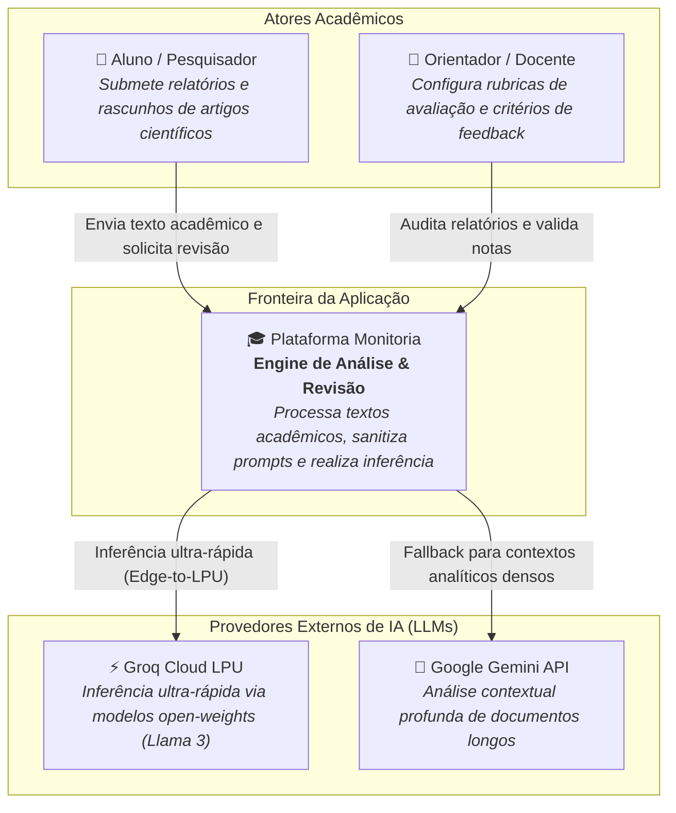
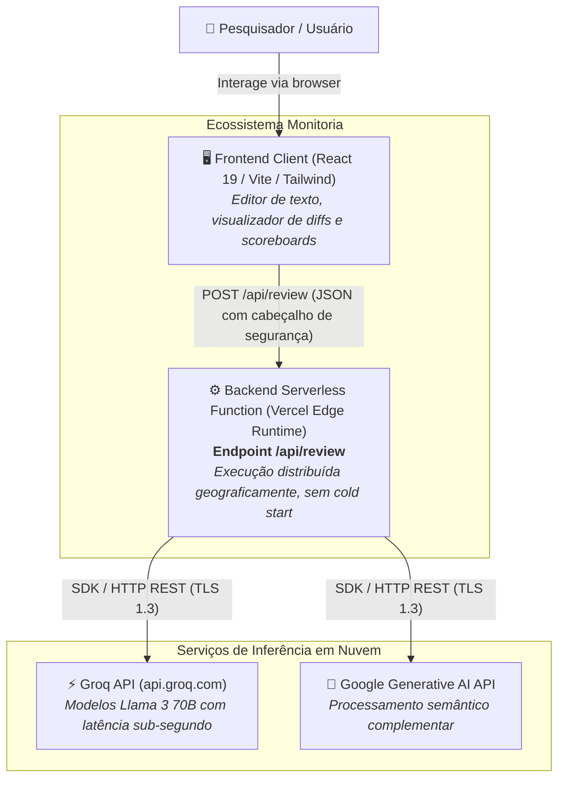
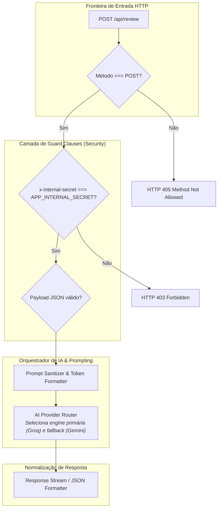

# Monitoria — Plataforma de Revisão Acadêmica & Edge Serverless AI

[](https://vercel.com/docs/functions/edge-functions)
[](https://www.typescriptlang.org/)
[-blueviolet?style=flat-square)](https://groq.com/)
[](#-arquitetura-de-software--modelo-c4)
[](api/review.ts)

Sistema de engenharia backend e computação na borda (*Edge Computing*) para **revisão, análise semântica e auditoria automatizada de artigos científicos e relatórios acadêmicos**. Utiliza roteamento de baixa latência em Edge Functions com orquestração multi-provedor entre Google Gemini e Groq Cloud (Llama 3).

---

## 🏛️ Arquitetura de Software — Modelo C4

```
Nível 1: Contexto Sistêmico  ────────► Alunos, Professores e Provedores de Inferência de IA
Nível 2: Contêineres         ────────► Frontend SPA e Backend Serverless Edge Function (Vercel)
Nível 3: Componentes Backend ────────► Guard Clauses, Orquestrador de Provedor e Parsers
Nível 4: Código & Contratos  ────────► Contratos de Tipagem de Payload e Respostas
```

---

### Nível 1: Diagrama de Contexto (System Context)



---

### Nível 2: Diagrama de Contêineres (Containers)



---

### Nível 3: Diagrama de Componentes (Edge Backend Components)

Zoom no fluxo interno do manipulador serverless [api/review.ts](api/review.ts):



---

### Nível 4: Código & Contratos de Tipagem (Code Contracts)

```mermaid
classDiagram
    class ReviewRequest {
        +string systemPrompt
        +string prompt
        +string? provider
        +number? temperature
    }

    class ReviewResponse {
        +boolean success
        +string reviewMarkdown
        +string providerUsed
        +number latencyMs
        +string? error
    }

    class EdgeHandler {
        +config: { runtime: "edge" }
        +handler(Request req) Promise~Response~
    }

    EdgeHandler ..> ReviewRequest : consome
    EdgeHandler ..> ReviewResponse : retorna
```

---

## 🛠️ Stack Tecnológica & Decisões de Backend

| Pilar | Tecnologia | Racional de Arquitetura |
|---|---|---|
| **Arquitetura Backend** | **Vercel Edge Functions** | Execução semântica na CDN mais próxima do usuário com cold start de 0ms. |
| **Segurança na Borda** | **Secret Header Guard** | Proteção de endpoints contra chamadas públicas não autorizadas via validação `x-internal-secret`. |
| **Inferência de IA** | **Groq LPU + Google Gemini** | Estratégia multi-provedor para redundância operacional e latência reduzida. |
| **Linguagem** | **TypeScript** | Contratos de interface tipados entre o cliente e a função serverless. |

---

## 🚀 Execução Local

```bash
# 1. Instalar dependências
npm install

# 2. Configurar variáveis no .env
# APP_INTERNAL_SECRET=sua-chave-secreta
# GROQ_API_KEY=gsk_...
# GEMINI_API_KEY=AIza...

# 3. Rodar ambiente de desenvolvimento
npm run dev
```

---

<div align="center">
  <sub>Documentação arquitetural C4 elaborada com foco em Engenharia de Software e Serverless Edge Computing.</sub>
</div>
